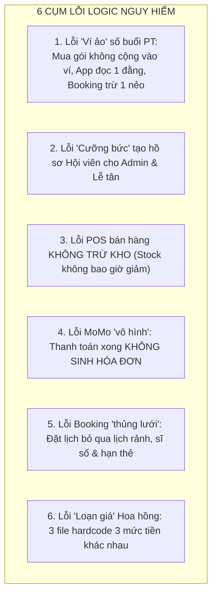

# 🔍 BÁO CÁO ĐỐI CHIẾU TOÀN DIỆN: CODE THỰC TẾ vs TÀI LIỆU NGHIỆP VỤ

> **Mục đích:** Rà soát từng file API Backend, Database Schema và Frontend đối chiếu với bản đặc tả gốc [Nghiệp_vụ.txt](file:///e:/DATN_Quan/Nghiệp_vụ.txt).  
> **Phát hiện:** Hệ thống đang tồn tại **6 cụm lỗi logic kinh điển** sinh ra do các lần code ngắt quãng bằng AI context nhỏ (mỗi file viết một kiểu, không đồng bộ dữ liệu giữa các luồng).

---

## 🚨 BẢNG TỔNG HỢP 6 LỖI LOGIC NGHIÊM TRỌNG TRONG CODE



---

## 📌 CHI TIẾT TỪNG LỖI & PHƯƠNG ÁN KHẮC PHỤC

---

### ❌ LỖI 1: Luồng Số Buổi PT Bị "Gãy Đôi" Giữa Mua Gói & Đặt Lịch
*Mức độ: 🔴 Cực kỳ nghiêm trọng (Bug cốt lõi của App)*

#### Thực trạng trong code:
1. **Khi Hội viên mua gói:**
   - Tại `API/src/routes/membership.route.ts` (dòng 98-107) và `API/src/routes/pos.route.ts` (dòng 78-87): Khi mua gói thành công, code chỉ ghi `remainingPtSessions: plan.ptSessions` vào bảng con `MemberSubscription`.
   - **Hoàn toàn KHÔNG cộng dồn vào ví tổng `MemberProfile.remainingPtSessions`!**
2. **Khi Hội viên đặt lịch PT:**
   - Tại `API/src/routes/booking.route.ts` (dòng 106-112): Code lại kiểm tra `memberProfile.remainingPtSessions <= 0` để chặn không cho đặt.
   - **Hậu quả:** Khách vừa bỏ hàng triệu đồng mua gói xong, bấm vào đặt lịch PT thì bị báo: *"Hội viên đã hết buổi tập PT. Vui lòng mua thêm gói bổ sung"*!
3. **Khi mở Dashboard trên Mobile:**
   - Tại `API/src/routes/member.route.ts` (dòng 44): Code lại lấy số buổi từ `activeSub.remainingPtSessions`. Nếu khách mua gói tập chính kèm thêm 1 gói lẻ 10 buổi PT, Dashboard chỉ hiện số của gói đầu tiên, giấu nhẹm 10 buổi PT kia!

#### 👉 Giải pháp chuẩn theo `Nghiệp_vụ.txt`:
- Đổi tên `MemberSubscription.remainingPtSessions` ➔ **`grantedPtSessions`** (Số buổi cấp theo hợp đồng này).
- `MemberProfile.remainingPtSessions` là **Ví tổng duy nhất**.
- Bất cứ khi nào mua gói (dù qua POS, App hay MoMo), code phải gọi:
  ```typescript
  await prisma.memberProfile.update({
    where: { id: memberId },
    data: { remainingPtSessions: { increment: plan.ptSessions } }
  });
  ```
- Dashboard và Booking chỉ đọc đúng 1 trường duy nhất: `memberProfile.remainingPtSessions`.

---

### ❌ LỖI 2: Admin & Lễ Tân Bị Ép Thành "Hội Viên Tập Gym"
*Mức độ: 🟠 Nghiêm trọng (Lỗi kiến trúc Database)*

#### Thực trạng trong code:
- Tại `API/src/routes/user.route.ts` (dòng 68):
  ```typescript
  memberProfile: (role === 'MEMBER' || role === 'RECEPTIONIST' || role === 'ADMIN' || !role) 
    ? { create: {} } : undefined
  ```
- Khi tạo tài khoản Admin hoặc Lễ tân, con AI trước đó tự động tạo luôn 1 bản ghi `MemberProfile` (có cả mã vân tay, số buổi tập) cho Admin và Lễ tân!
- **Nguyên nhân:** Do bảng `User` không có trường `avatarUrl`, nên AI phải tạo `MemberProfile` cho Admin/Lễ tân chỉ để... có chỗ lưu cái avatar!
- Cùng lúc đó, bảng `TrainerProfile` lại gánh thêm 3 trường `height`, `weight`, `bodyFat` (trong khi PT tự đo Inbody lại lưu ở bảng `BodyMetric` với `memberId: null` tại `API/src/routes/metrics.route.ts` dòng 89).

#### 👉 Giải pháp chuẩn:
- Thêm `avatarUrl String?` trực tiếp lên bảng `User`.
- Admin và Lễ tân chỉ là tài khoản `User` thuần túy, tuyệt đối không tạo `MemberProfile`.
- Xóa bỏ 3 cột `height`, `weight`, `bodyFat` ở `TrainerProfile`.

---

### ❌ LỖI 3: Màn Hình POS Bán Hàng KHÔNG HỀ Trừ Kho
*Mức độ: 🔴 Cực kỳ nghiêm trọng (Thất thoát hàng hóa)*

#### Thực trạng trong code:
- Tại `API/src/routes/pos.route.ts` (dòng 60-70): Lễ tân bán nước ngọt, Whey, găng tay tập... Hệ thống tính tiền, in hóa đơn `Invoice` và tạo `InvoiceItem`.
- **Nhưng KHÔNG CÓ BẤT KỲ DÒNG CODE NÀO trừ số lượng tồn kho `Product.stock`!**
- Tồn kho hiển thị trên trang Quản lý kho (`/inventory`) sẽ mãi mãi giữ nguyên số lượng ban đầu dù đã bán hàng trăm chai nước.

#### 👉 Giải pháp chuẩn:
- Bổ sung logic trừ kho bằng Transaction ngay trong lúc tạo hóa đơn:
  ```typescript
  if (item.productId) {
    await tx.product.update({
      where: { id: item.productId },
      data: { stock: { decrement: item.quantity } }
    });
  }
  ```

---

### ❌ LỖI 4: Thanh Toán MoMo "Vô Hình" — Tiền Vào Nhưng Không Có Hóa Đơn
*Mức độ: 🔴 Cực kỳ nghiêm trọng (Mất cân đối dòng tiền kế toán)*

#### Thực trạng trong code:
- Tại `API/src/routes/payment.route.ts` (dòng 65-111): Khi khách thanh toán gói tập qua MoMo thành công (Webhook IPN trả về), code kích hoạt gói `MemberSubscription`...
- **Nhưng KHÔNG HỀ TẠO `Invoice`!**
- Hậu quả:
  + Mọi báo cáo doanh thu tại `API/src/routes/stats.route.ts` (dòng 14) đều đếm từ bảng `Invoice`.
  + Toàn bộ tiền khách thanh toán qua MoMo đều bị "bốc hơi" khỏi biểu đồ doanh thu của Admin!
  + Khách hàng vào mục "Lịch sử giao dịch" trên App cũng không thấy hóa đơn đâu.

#### 👉 Giải pháp chuẩn:
- Khi MoMo IPN trả về `resultCode === 0`:
  1. Kích hoạt gói tập & cộng dồn số buổi PT vào `MemberProfile`.
  2. Tạo ngay 1 bản ghi `Invoice` với `paymentMethod: 'MOMO'`, kèm `InvoiceItem` (`planId`, `unitPrice`, `subTotal`).

---

### ❌ LỖI 5: Đặt Lịch (Booking) Bị "Thủng Lưới" Toàn Bộ Ràng Buộc Nghiệp Vụ
*Mức độ: 🟠 Nghiêm trọng (Sai quy trình vận hành)*

Trong tài liệu `Nghiệp_vụ.txt` (dòng 207-211) quy định 4 luật thép:
1. *Không có thẻ còn hạn -> Không được đặt lịch lớp nhóm.* (Hiện tại: Ai cũng bấm đặt được).
2. *Lớp học nhóm vượt quá sĩ số `capacity` -> Khóa không cho đặt thêm.* (Hiện tại: `API/src/routes/booking.route.ts` không hề đếm số người đã đặt, lớp 10 người có thể đặt lên 100 người).
3. *Chỉ được đặt PT vào giờ rảnh đã khai báo.* (Hiện tại: Khách đặt bất kỳ giờ nào, không hề kiểm tra bảng `TrainerAvailability`).
4. *Xác nhận hoàn thành buổi tập bị đá nhau giữa 2 API:*
   - Endpoint `PATCH /api/bookings/:id` đọc tỷ lệ hoa hồng từ `CommissionRate`.
   - Endpoint `POST /api/bookings/:id/complete-with-qr` lại hardcode cứng 50.000đ.

#### 👉 Giải pháp chuẩn:
- Trong API đặt lịch `POST /api/bookings`:
  + Kiểm tra thẻ tập active.
  + Nếu đặt lớp: Check `Booking.count({ where: { groupClassId } }) < groupClass.capacity`.
  + Nếu đặt PT: Check trùng lịch & check slot rảnh.
- Gộp logic hoàn thành buổi tập về 1 hàm chuẩn dùng chung, đọc hoa hồng từ `CommissionRate`.

---

### ❌ LỖI 6: "Loạn Mức Tiền" Hoa Hồng PT (Mỗi File Một Phách)
*Mức độ: 🟡 Trung bình*

- Tại `API/src/routes/trainer.route.ts` (dòng 47): Dashboard PT tính thu nhập ước tính = `số buổi * 150.000đ`.
- Tại `API/src/routes/booking.route.ts` (dòng 255): Khi quét mã hoàn thành buổi dạy lại cộng vào log hoa hồng = `50.000đ`.
- Bảng `CommissionRate` sinh ra để quản lý mức hoa hồng thì bị bỏ quên, không ai đụng tới!

#### 👉 Giải pháp chuẩn:
- Seed dữ liệu vào `CommissionRate` (VD: Hoa hồng dạy PT = 50.000đ/buổi, Hoa hồng bán gói = 10%).
- Cả Dashboard PT lẫn lúc kết thúc buổi tập đều đọc chung từ `CommissionRate`.
