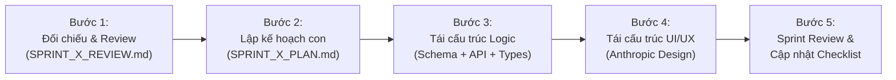
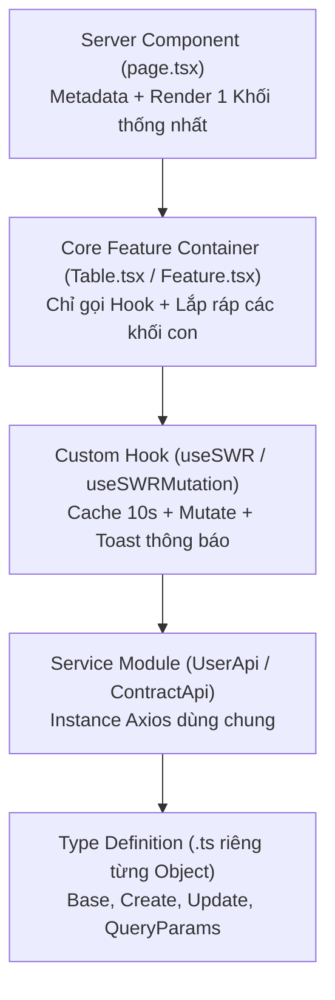

# 🏆 KẾ HOẠCH TỔNG THỂ TỐI ƯU HỆ THỐNG TITAN GYM (MÔ HÌNH SPRINT)

> **Phương châm:** *Xây móng từ trong ra ngoài (Foundation → Core Logic → Transaction → Management)*  
> **Tiêu chuẩn thiết kế:** Áp dụng triệt để **Anthropic Frontend Design Philosophy** — Xóa bỏ hoàn toàn template tím neon AI rập khuôn; chuyển sang phong cách **Industrial Athletic & High-Performance UI** (Hiện đại, tối giản, thực dụng, tương phản cao, typography chuyên nghiệp).

---

## 🔄 QUY TRÌNH 5 BƯỚC BẮT BUỘC TRONG MỖI SPRINT

Mỗi Sprint sẽ được vận hành khép kín và độc lập theo đúng chu trình:

1. **Bước 1 — Đối chiếu & Review chi tiết:** Soi từng dòng code API/Frontend với [Nghiệp_vụ.txt](file:///e:/DATN_Quan/Nghiệp_vụ.txt), lập file `SPRINT_X_REVIEW.md`.
2. **Bước 2 — Lập Kế hoạch con chi tiết:** Lên danh sách task cụ thể cho Schema, API, Types, UI, lập file `SPRINT_X_PLAN.md`.
3. **Bước 3 — Chỉnh sửa Logic nghiệp vụ:** Refactor Schema, Migration, API routes, Seed data và Type definitions.
4. **Bước 4 — Chỉnh sửa Giao diện (Frontend Design):** Thiết kế lại giao diện loại bỏ phong cách AI tím neon; tối ưu hóa layout, thông tin hiển thị, micro-interactions thực dụng.
5. **Bước 5 — Sprint Review & Checklist:** Kiểm thử chức năng toàn diện (E2E) và tích dấu `[x]` vào Checklist tổng quát dưới đây.

---

## 🎨 TIÊU CHUẨN DESIGN PATTERN & KIẾN TRÚC CODEBASE
> **Nguồn tham chiếu:** Chuẩn hóa 100% theo phong cách kiến trúc của tác giả từ dự án `E:\datn\Project\Admin dashboard WebApp` và triết lý **Anthropic Frontend Design**.  
> **Lưu ý Backend:** Giữ nguyên kiến trúc Express + Prisma hiện tại của repo này (vì đã gọn nhẹ và phù hợp), tuyệt đối không học hay lai ghép với ASP.NET Core của repo mẫu.

### 1. Kiến trúc Phân Tầng Tuyệt Đối (Strict Separation of Concerns)
Nguyên tắc bất di bất dịch: **Giao diện CHỈ ĐỂ RENDER và GỌI HOOK — Tuyệt đối KHÔNG xử lý logic nghiệp vụ hay gọi API trực tiếp ở giao diện.**

#### A. Tách biệt Type riêng biệt theo từng Object (`src/types/<object>.ts`)
- Mỗi thực thể kinh doanh có đúng 1 file type độc lập (ví dụ: `user.ts`, `membership.ts`, `product.ts`, `booking.ts`, `hrm.ts`...).
- Trong mỗi file type luôn chứa đầy đủ bộ Interface chuẩn:
  + `Interface Entity`: Model đầy đủ để Get & hiển thị dữ liệu.
  + `Interface CreateEntity`: DTO cho payload thêm mới.
  + `Interface UpdateEntity`: DTO cho payload chỉnh sửa (các trường optional).
  + `Interface EntityQueryParams`: Định nghĩa tham số lọc (`page`, `limit`, `keyword`, `status`...).
  + Export tập trung toàn bộ qua `src/types/index.ts`.

#### B. Tầng Service API với 1 Instance Axios Duy Nhất (`src/services/`)
- Cấu hình 1 instance `axios.ts` duy nhất: có timeout, interceptors tự động gán header `platform = 'web'`, baseURL lấy từ `constants`.
- Mỗi module nghiệp vụ có 1 file API riêng (`user.ts`, `membership.ts`, `pos.ts`...) export các hàm CRUD (`get...`, `create...`, `update...`, `delete...`).
- Export tập trung qua `src/services/index.ts` (ví dụ: `UserApi`, `MembershipApi`, `PosApi`).

#### C. Tầng Custom Hooks với SWR (`src/hooks/`)
- **Query Data:** Dùng `useSWR(["key", params], fetcher, { dedupingInterval: 10000, revalidateOnFocus: false })` để tự động cache, chống spam request.
- **Mutate Data:** Dùng `useSWRMutation` cho các hành động Create, Update, Delete.
- **Phản hồi người dùng & Revalidate:** Khi mutate thành công, tự động gọi `Toast.show({ title, message, variant })` từ ToastContext toàn cục và kích hoạt `mutate()` để bảng tự làm mới dữ liệu tức thì.

#### D. Tầng Hằng Số Tập Trung (`src/constants/`)
- Lưu trữ toàn bộ các biến bất biến trong `constants.ts`:
  + `constants.routes`: Toàn bộ Relative URLs của các trang (chống hardcode link trong component).
  + `constants.url.api`: Đường dẫn Base API Backend.
  + `constants.limit`: Phân trang mặc định (10 hoặc 20).

#### E. Tầng Component Core & Server Component Page
- **Page (`src/app/**/page.tsx`):** Luôn là **Server Component** để định nghĩa `export const metadata: Metadata`, thân hàm `page()` siêu tinh gọn: **CHỈ GỌI ĐÚNG 1 COMPONENT THỐNG NHẤT** của module đó (ví dụ: `<UserTable />` hoặc `<POSContainer />`).
- **Khối thống nhất (`src/components/core/<module>/`):**
  - File chính: `Table.tsx` hoặc `Main.tsx`.
  - Lắp ráp từ các khối con nhỏ: `TableHeader.tsx`, `TableRow.tsx`, `ModalCreate.tsx`, `ModalEdit.tsx`.
  - Sử dụng các UI components dùng chung chuẩn doanh nghiệp: `PageBreadcrumb`, `ComponentCard`, `Table`, `Pagination`.

---

### 2. Kiến trúc Bố cục Layout (Layout Architecture)
Áp dụng mẫu bố cục từ `Admin dashboard WebApp/src/layout` cho Admin Web và đồng bộ tư duy sang Mobile App:
- **`AppSidebar.tsx`:** Thu gọn (`90px`), mở rộng (`290px`), hover và hỗ trợ drawer trên mobile qua `isMobileOpen` với `transition-all duration-300`.
- **`AppHeader.tsx`:** Thanh tiêu đề chuẩn gồm breadcrumb, profile menu, avatar, status indicator.
- **`Backdrop.tsx`:** Lớp overlay làm mờ khi mở sidebar trên Tablet/Mobile.
- **`SidebarContext.tsx`:** React Context quản lý trạng thái sidebar toàn cục.
- **`CoreLayout.tsx`:** Khung wrapper chuẩn `max-w-[1920px]`.

---

### 3. Ngôn ngữ Thiết kế (Anthropic Frontend Design & Design Tokens Chuẩn)
- **Bài trừ AI Tropes:** Xóa bỏ hoàn toàn template màu tím neon, gradient hồng/tím vô nghĩa, viền phát sáng mờ ảo (glow blur), và các khối glassmorphism đục ngầu che khuất thông tin.
- **Phân tách chuyên biệt 2 hệ thống thị giác (Admin Web vs Mobile App):**

#### 🖥️ A. Bộ Màu & Typography cho Admin Dashboard (Quản lý phòng Gym)
* **Phong cách:** Tối giản kiểu Thụy Sĩ & Công nghiệp (`Warm Editorial / Clean Slate`). Nền sáng dịu như giấy giúp quản lý nhìn bảng biểu, doanh thu, lịch tập cả ngày không bị chói hay mỏi mắt.
* **Cặp font chuẩn:**
  - **Tiêu đề:** `Plus Jakarta Sans` (đậm, hiện đại, sắc sảo).
  - **Số liệu / Bảng biểu:** `JetBrains Mono` (căn thẳng hàng tabular figures cực chuẩn, dễ quét mắt đối chiếu).
* **Bảng Design Tokens cho Admin Dashboard:**
  | Vai trò màu | Tên màu | Mã Hex | Ứng dụng trên Dashboard |
  | :--- | :--- | :--- | :--- |
  | **Nền chính (Background)** | Warm Alabaster | `#F7F7F5` | Nền tổng thể của toàn bộ trang dashboard |
  | **Nền thẻ & Sidebar (Surface)** | Pure White | `#FFFFFF` | Các thẻ thống kê, bảng danh sách, menu trái (viền `#E4E4E0`) |
  | **Chữ chính (Primary Text)** | Deep Charcoal | `#18181B` | Tiêu đề, số liệu doanh thu, tên hội viên |
  | **Chữ phụ (Muted Text)** | Slate Gray | `#6E6E77` | Nhãn mô tả, ngày tháng, thông tin phụ |
  | **Màu nhấn chính (Primary Accent)** | Electric Tangerine | `#EA580C` | Nút tạo mới, biểu đồ tăng trưởng, trạng thái "Đang hoạt động" |
  | **Màu nhấn phụ (Secondary Accent)** | Forest Pine | `#15803D` | Chỉ số doanh thu dương, gói tập còn hạn |

---

#### 📱 B. Bộ Màu & Typography cho App Hội viên & PT (User & PT Mobile App)
* **Phong cách:** Thể thao hiệu suất cao (`High-Performance Kinetic Dark`). Khi ở trong phòng tập (ánh sáng đèn trần gắt hoặc tập ngoài trời), giao diện nền tối sâu kết hợp màu nhấn Xanh Chanh (Volt Lime) như các dòng đồ thể thao Nike/Whoop giúp người tập và PT liếc nhanh 1 giây là thấy ngay thông số hiệp tập (reps/sets) hay nút bấm check-in, đồng thời tối ưu pin màn hình OLED.
* **Cặp font chuẩn:**
  - **Tiêu đề / Số đếm hiệp tập:** `Barlow Condensed` (mạnh mẽ, góc cạnh, thể thao).
  - **Nội dung:** `DM Sans` (dễ đọc, rõ ràng trên kích thước màn hình điện thoại).
* **Bảng Design Tokens cho Mobile App:**
  | Vai trò màu | Tên màu | Mã Hex | Ứng dụng trên App Mobile |
  | :--- | :--- | :--- | :--- |
  | **Nền chính (Background)** | Obsidian Black | `#0E100F` | Nền tổng thể của ứng dụng (tiết kiệm pin màn hình OLED) |
  | **Nền thẻ bài tập (Surface)** | Carbon Gray | `#1A1D1B` | Khung thẻ lịch tập hôm nay, hồ sơ PT, biểu đồ calo |
  | **Chữ chính (Primary Text)** | Crisp Off-White | `#F4F5F0` | Tên bài tập, số kg tạ, đồng hồ đếm ngược |
  | **Chữ phụ (Muted Text)** | Ash Gray | `#8E9490` | Ghi chú kỹ thuật, thời gian nghỉ giữa hiệp |
  | **Màu nhấn chính (Primary Accent)** | Kinetic Volt | `#C8F135` | Nút "Bắt đầu tập", hoàn thành hiệp (chữ trên nút dùng màu `#0E100F`) |
  | **Màu nhấn phụ (Secondary Accent)** | Signal Coral | `#FF5A36` | Cảnh báo hết hạn gói tập, nhịp tim cao, hủy lịch PT |

---

## 📋 MASTER CHECKLIST 5 SPRINT

---

### 🏃 SPRINT 1: Tầng Móng Định Danh & Tài Khoản (User, MemberProfile, TrainerProfile)
- [x] **Bước 1: Đối chiếu & Review**
  - [x] Soi code `user.route.ts`, `trainer.route.ts`, `auth.route.ts` với `Nghiệp_vụ.txt`
  - [x] Tạo tài liệu `SPRINT_1_REVIEW.md`
- [x] **Bước 2: Kế hoạch Sprint 1**
  - [x] Tạo tài liệu `SPRINT_1_PLAN.md` chi tiết từng hàm, từng component
- [x] **Bước 2.5: User thông qua plan**
- [x] **Bước 3: Tái cấu trúc Logic & Schema**
  - [x] Schema: Thêm `User.avatarUrl`, xóa `avatarUrl` ở 2 profile, xóa `height, weight, bodyFat` ở `TrainerProfile`
  - [x] Migration & Generate Prisma Client
  - [x] Sửa `user.route.ts`: Xóa bỏ triệt để việc tự động tạo dummy `MemberProfile` cho Admin/Lễ tân
  - [x] Sửa `trainer.route.ts`: Bỏ nhận 3 trường rác, lưu avatar trực tiếp lên User
  - [x] Cập nhật `seed.ts` cho tài khoản chuẩn
- [x] **Bước 4: Tái cấu trúc Giao diện (Anthropic UI)**
  - [x] Thiết kế lại màn hình Hồ sơ cá nhân (Profile) trên Mobile App (Member & PT)
  - [x] Thiết kế lại giao diện Quản lý tài khoản nhân viên trên Admin Web (`/staff` tab Nhân viên)
- [x] **Bước 5: Sprint Review & Nghiệm thu**
  - [x] Test tạo Lễ tân mới -> Không bị sinh rác `MemberProfile`
  - [x] Test upload/đổi avatar trên Web & Mobile -> Hiển thị sắc nét, đồng bộ

---

### 🎫 SPRINT 2: Gói Tập & Quyền Lợi Hội Viên (MembershipPlan, MemberSubscription)
- [x] **Bước 1: Đối chiếu & Review**
  - [x] Soi code `membership.route.ts`, `member.route.ts` với quy tắc Stacking và Ví số buổi trong `Nghiệp_vụ.txt`
  - [x] Tạo tài liệu `SPRINT_2_REVIEW.md`
- [x] **Bước 2: Kế hoạch Sprint 2**
  - [x] Tạo tài liệu `SPRINT_2_PLAN.md`
- [x] **Bước 2.5: User thông qua plan**
- [x] **Bước 3: Tái cấu trúc Logic & Schema**
  - [x] Schema: Đổi tên `MemberSubscription.remainingPtSessions` ➔ `grantedPtSessions`
  - [x] Migration & Generate Prisma Client
  - [x] Sửa `membership.route.ts`: Khi mua/gia hạn gói, bắt buộc `increment` số buổi vào ví tổng `MemberProfile.remainingPtSessions`
  - [x] Sửa `member.route.ts`: Dashboard đọc số buổi PT còn lại từ `MemberProfile.remainingPtSessions`
  - [x] Cập nhật `seed.ts`
- [x] **Bước 4: Tái cấu trúc Giao diện (Anthropic UI)**
  - [x] Thiết kế lại thẻ E-card Hội viên & Dashboard Member trên Mobile App (Hiện rõ: Tên gói, Hạn dùng, Số ngày còn lại, Số buổi PT trong ví)
  - [x] Thiết kế lại trang Danh mục Gói tập trên Admin Web (`/catalog` & Landing Page)
- [x] **Bước 5: Sprint Review & Nghiệm thu**
  - [x] Test mua gói mới -> Mở Dashboard thấy số buổi PT tăng ngay lập tức
  - [x] Test hợp đồng gói tập: Hiển thị đúng `grantedPtSessions` (Số buổi được cấp)

---

### 💳 SPRINT 3: Bán Hàng POS, Kho & Hóa Đơn (Product, Invoice, InvoiceItem)
- [x] **Bước 1: Đối chiếu & Review**
  - [x] Soi code `pos.route.ts`, `payment.route.ts`, `stats.route.ts` với quy trình Thu ngân & Kho trong `Nghiệp_vụ.txt`
  - [x] Tạo tài liệu `SPRINT_3_REVIEW.md`
- [x] **Bước 2: Kế hoạch Sprint 3**
  - [x] Tạo tài liệu `SPRINT_3_PLAN.md`
- [x] **Bước 2.5: User thông qua plan**
- [x] **Bước 3: Tái cấu trúc Logic & Schema**
  - [x] Schema: Thêm cột `InvoiceItem.unitPrice`
  - [x] Migration & Generate Prisma Client
  - [x] Sửa `pos.route.ts`: Bổ sung Transaction trừ tồn kho `Product.stock` khi bán lẻ
  - [x] Sửa `pos.route.ts`: Khi bán gói tập tại quầy, cộng dồn buổi PT vào ví khách
  - [x] Sửa `payment.route.ts`: Khi MoMo IPN thành công, tạo ngay `Invoice` + `InvoiceItem` và cộng buổi vào ví khách
- [x] **Bước 4: Tái cấu trúc Giao diện (Anthropic UI)**
  - [x] Thiết kế lại màn hình POS Bán hàng trên Admin Web: Bố cục 2 cột trực quan (Danh mục lưới sản phẩm bên trái, Giỏ hàng & Hóa đơn bên phải, phím tắt nhanh)
  - [x] Thiết kế lại giao diện Quản lý kho hàng (`/inventory`)
- [x] **Bước 5: Sprint Review & Nghiệm thu**
  - [x] Bán 2 chai nước -> Tồn kho giảm đúng 2
  - [x] Thanh toán MoMo -> Dashboard Admin nhảy số doanh thu ngay lập tức

---

### 🥊 SPRINT 4: Vận Hành Lớp Học, Đặt Lịch & Giáo Án (GroupClass, Booking, WorkoutLog, WorkoutExercise)
- [x] **Bước 1: Đối chiếu & Review**
  - [x] Soi code `booking.route.ts`, `workout.route.ts` với 4 quy tắc Booking Rules trong `Nghiệp_vụ.txt`
  - [x] Tạo tài liệu `SPRINT_4_REVIEW.md`
- [x] **Bước 2: Kế hoạch Sprint 4**
  - [x] Tạo tài liệu `SPRINT_4_PLAN.md`
- [x] **Bước 2.5: User thông qua plan**
- [x] **Bước 3: Tái cấu trúc Logic & Schema**
  - [x] Schema: Thêm `GroupClass.trainerId` liên kết với `TrainerProfile`
  - [x] Migration & Generate Prisma Client
  - [x] Sửa `booking.route.ts`: Bổ sung kiểm tra hạn thẻ active khi đặt lớp
  - [x] Sửa `booking.route.ts`: Bổ sung kiểm tra sĩ số lớp (`capacity`) chống quá tải
  - [x] Sửa `booking.route.ts`: Bổ sung kiểm tra lịch rảnh của PT (`TrainerAvailability`)
  - [x] Thống nhất 2 API hoàn thành buổi tập về 1 luồng chuẩn
- [x] **Bước 4: Tái cấu trúc Giao diện (Anthropic UI)**
  - [x] Thiết kế lại giao diện Đặt lịch & Lịch tập (Calendar) trên Mobile App (cho cả Member và PT)
  - [x] Thiết kế lại giao diện Quản lý thời khóa biểu lớp học trên Admin Web (`/schedule`)
  - [x] Thiết kế lại form nhập Giáo án & Bài tập cho PT trên Mobile
- [x] **Bước 5: Sprint Review & Nghiệm thu**
  - [x] Test đặt lớp khi hết hạn thẻ -> Bị chặn
  - [x] Test đặt lớp quá sĩ số -> Bị chặn
  - [x] Test PT quét mã QR xác nhận -> Ví khách trừ 1 buổi, lịch chuyển COMPLETED

---

### 📊 SPRINT 5: Quản Trị Nhân Sự, Hoa Hồng & KPI (StaffShift, CommissionRate, StaffKPI, CommissionLog)
- [x] **Bước 1: Đối chiếu & Review**
  - [x] Soi code `hrm.route.ts`, `trainer.route.ts` (dashboard) với quy định tính lương/thưởng trong `Nghiệp_vụ.txt`
  - [x] Tạo tài liệu `SPRINT_5_REVIEW.md`
- [x] **Bước 2: Kế hoạch Sprint 5**
  - [x] Tạo tài liệu `SPRINT_5_PLAN.md`
- [x] **Bước 2.5: User thông qua plan**
- [x] **Bước 3: Tái cấu trúc Logic & Seed Data**
  - [x] Schema: Thêm `User.baseSalary` và `StaffKPI.@@unique([userId, month, year])`
  - [x] Nạp dữ liệu seed chuẩn vào `seed.ts`: Chính sách hoa hồng (Dạy PT 50k, Bán gói 10%), Lịch trực tuần, Chỉ tiêu KPI tháng, Nhật ký hoa hồng mẫu
  - [x] Sửa `trainer.route.ts`: Xóa bỏ số hardcode 150k, đọc thu nhập từ `CommissionLog.aggregate` và trả về kèm tiến độ KPI tháng
  - [x] Sửa `booking.route.ts`: Đọc từ `CommissionRate`
  - [x] Bổ sung API Bảng lương tự động `/hrm/payroll` (Lương cứng + Hoa hồng + Đánh giá xếp loại)
- [x] **Bước 4: Tái cấu trúc Giao diện (Warm Editorial & Kinetic Dark)**
  - [x] Thiết kế lại toàn diện trang Quản trị Nhân sự (`/staff`) trên Admin Web với 4 tab sạch đẹp, chuyên nghiệp:
    + Tab 1: Danh sách nhân sự & Phân quyền (`StaffTable`)
    + Tab 2: Lịch trực tuần (`ShiftManagement` & `ModalCreateShift`)
    + Tab 3: Cấu hình hoa hồng & Bảng tính lương tự động (`PayrollManagement` & `ModalCommissionRate`)
    + Tab 4: Bảng theo dõi KPI doanh số (`KpiManagement` & `ModalSetKpi`)
  - [x] Thiết kế lại giao diện PT trên Mobile App sang High-Performance Kinetic Dark (`index.tsx`, `clients.tsx`, `schedule.tsx`, `availability.tsx`)
- [x] **Bước 5: Sprint Review & Nghiệm thu**
  - [x] Mở `/staff` thấy 4 tab sáng đèn đầy đủ số liệu thực tế
  - [x] Dashboard PT trên Mobile khớp hoàn toàn số tiền hoa hồng với Admin Web
  - [x] Script `verify_sprint5.ts` vượt qua toàn bộ 5 bài kiểm tra với 0 lỗi
  - [x] Admin Web Turbopack build 15 routes tĩnh 100% không lỗi
  - [x] Mobile App `tsc` không có bất kỳ lỗi TypeScript nào
