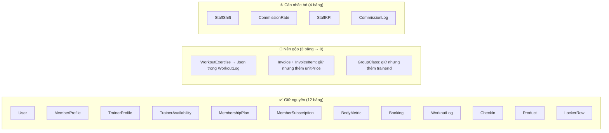

# 🔍 Đánh Giá Database Schema — Titan Gym (20 bảng)

Phân tích từng bảng trong [schema.prisma](file:///e:/DATN_Quan/API/prisma/schema.prisma) dựa trên nguyên tắc chuẩn hoá CSDL:
- **Trường dữ liệu có riêng biệt chưa?** (Không lặp lại ý nghĩa giữa các bảng)
- **Có chỗ nào nên gộp?** (Hai bảng quan hệ 1:1 mà cùng vòng đời → gộp)
- **Có chỗ nào nên tách?** (Một bảng chứa dữ liệu đa mục đích, dễ gây rỗng)

---

## 1. `User` — ✅ Hợp lý

| Trường | Nhận xét |
|--------|----------|
| `phone`, `passwordHash`, `fullName`, `role` | Đúng trách nhiệm: xác thực & phân quyền |
| `isActive`, `createdAt`, `updatedAt` | Chuẩn audit fields |

> [!TIP]
> Trường `avatarUrl` hiện nằm tách ở cả `MemberProfile` lẫn `TrainerProfile`. Nên **kéo lên `User`** vì mọi role đều có thể cần avatar (kể cả Receptionist, Admin).

---

## 2. `MemberProfile` — ⚠️ Có vấn đề dư thừa

| Trường | Nhận xét |
|--------|----------|
| `fingerprintId` | Riêng biệt, chỉ Member có → hợp lý tách bảng |
| `avatarUrl` | **Trùng mục đích** với `TrainerProfile.avatarUrl` → nên gộp lên `User` |
| `remainingPtSessions` | ❌ **DỮ LIỆU TRÙNG LẶP NGHIÊM TRỌNG** — cũng tồn tại trong `MemberSubscription.remainingPtSessions` |

> [!WARNING]
> ### Lỗi chuẩn hoá: `remainingPtSessions` lưu ở 2 nơi
> - `MemberProfile.remainingPtSessions` = **tổng buổi PT còn lại** (denormalized cache)
> - `MemberSubscription.remainingPtSessions` = buổi PT **theo từng gói**
>
> Trong code thực tế ([booking.route.ts#L106-L112](file:///e:/DATN_Quan/API/src/routes/booking.route.ts#L106-L112)), chỉ có `MemberProfile.remainingPtSessions` được dùng để kiểm tra khi đặt lịch, và chỉ `MemberProfile` bị trừ khi hoàn thành buổi tập ([booking.route.ts#L176-L178](file:///e:/DATN_Quan/API/src/routes/booking.route.ts#L176-L178)). Trường `MemberSubscription.remainingPtSessions` **không bao giờ được trừ** → sẽ sai lệch theo thời gian.
>
> **Giải pháp:** Chọn 1 trong 2:
> - **Cách A (Đơn giản — khuyên dùng cho ĐATN):** Chỉ giữ ở `MemberProfile`, bỏ ở `MemberSubscription`. Khi mua gói mới → cộng vào `MemberProfile`.
> - **Cách B (Chính xác hơn):** Chỉ giữ ở `MemberSubscription`, bỏ ở `MemberProfile`. Khi cần tổng thì `SUM()` các gói ACTIVE. Khi trừ buổi → trừ gói cũ nhất trước (FIFO).

---

## 3. `TrainerProfile` — ⚠️ Có trường thừa

| Trường | Nhận xét |
|--------|----------|
| `specialization`, `bio` | Riêng biệt, đúng trách nhiệm |
| `avatarUrl` | Trùng → gộp lên `User` |
| `height`, `weight`, `bodyFat` | ⚠️ **Mục đích mơ hồ** — đây là chỉ số tĩnh của PT (giới thiệu bản thân), không phải tracking theo thời gian. Nếu chỉ dùng để hiển thị hồ sơ PT → giữ. Nếu muốn PT cũng tracking body → nên dùng bảng `BodyMetric` chung. |

> [!NOTE]
> `TrainerProfile` quan hệ 1:1 với `User` → về lý thuyết **có thể gộp vào `User`** (thêm các trường `specialization?`, `bio?` nullable). Tuy nhiên việc tách bảng cũng hợp lý vì nó là điểm neo cho nhiều quan hệ khác (`Booking`, `WorkoutLog`, `BodyMetric`, `TrainerAvailability`). **Giữ nguyên là OK.**

---

## 4. `TrainerAvailability` — ✅ Hợp lý

| Trường | Nhận xét |
|--------|----------|
| `dayOfWeek`, `startTime`, `endTime` | Lịch rảnh theo tuần — đúng mô hình recurring schedule |
| `@@unique([trainerId, dayOfWeek, startTime])` | Ràng buộc tốt, tránh trùng slot |

Không cần thay đổi.

---

## 5. `MembershipPlan` — ✅ Hợp lý

Bảng danh mục chuẩn. Các trường (`name`, `price`, `durationDays`, `ptSessions`, `tag`) đều riêng biệt, không trùng lặp.

---

## 6. `MemberSubscription` — ⚠️ Dư 1 trường

| Trường | Nhận xét |
|--------|----------|
| `memberId`, `planId`, `startDate`, `endDate`, `status` | Đúng nghiệp vụ |
| `remainingPtSessions` | ❌ Trùng với `MemberProfile` (xem mục 2 ở trên) |

---

## 7. `BodyMetric` — ✅ Hợp lý

Bảng tracking theo thời gian (`recordedAt`), các trường (`weight`, `height`, `bmi`, `bodyFat`, `muscleMass`) đều thuộc 1 lần đo. Thiết kế chuẩn time-series.

> [!TIP]
> Trường `bmi` được tính từ `weight` và `height` (derived field). Có thể bỏ ra khỏi DB và tính khi hiển thị, nhưng lưu sẵn cũng chấp nhận được vì giá trị đã được fix tại thời điểm đo.

---

## 8. `GroupClass` — ⚠️ Thiếu trường

| Trường | Nhận xét |
|--------|----------|
| `name`, `capacity`, `startTime`, `endTime` | OK cho 1 buổi lớp cụ thể |

Thiếu trường:
- **`trainerId`** — ai dạy lớp này? Hiện không link tới PT nào.
- **`description`** — mô tả lớp (ví dụ: "Yoga cho người mới").
- **`dayOfWeek` hoặc `isRecurring`** — lớp Group thường lặp hàng tuần, nhưng hiện chỉ lưu 1 `startTime` cố định, seed data cũng **0 bản ghi**.

---

## 9. `Booking` — ✅ Hợp lý (nhưng có 1 điểm cần lưu ý)

Thiết kế bảng **đa mục đích** (đặt PT hoặc đặt lớp nhóm) thông qua 2 FK nullable (`trainerId?`, `groupClassId?`) là pattern phổ biến, chấp nhận được.

> [!NOTE]
> Trường `startTime` và `endTime` ở `Booking` **trùng ý nghĩa** với `GroupClass.startTime/endTime` khi booking thuộc lớp nhóm. Hiện code đang yêu cầu client gửi `startTime/endTime` riêng. Nếu muốn chặt chẽ hơn → khi `groupClassId != null`, tự copy thời gian từ `GroupClass` thay vì nhận từ client.

---

## 10. `WorkoutLog` — ✅ Hợp lý

| Trường | Nhận xét |
|--------|----------|
| `memberId`, `trainerId`, `bookingId?` | Liên kết đúng 3 chiều: ai tập, ai dạy, buổi nào |
| `notes`, `energyLevel`, `nutrition` | Metadata riêng biệt cho buổi tập |
| `date`, `createdAt` | ⚠️ **2 trường DateTime gần giống nhau** — `date` là ngày tập (lấy từ booking), `createdAt` là lúc PT nhập dữ liệu. Nếu luôn nhập trong ngày → thừa 1, nhưng nếu cho phép nhập muộn thì cần cả 2. Chấp nhận được. |

---

## 11. `WorkoutExercise` — 🔄 Ứng viên gộp vào `WorkoutLog`

| Trường | Nhận xét |
|--------|----------|
| `name`, `sets`, `reps`, `weight`, `notes` | 5 trường đơn giản |

Bảng này **quan hệ N:1** với `WorkoutLog`. Mỗi khi query giáo án đều phải `include: { exercises: true }` — không bao giờ query `WorkoutExercise` độc lập.

> [!TIP]
> ### Đề xuất gộp
> Thay vì bảng riêng, lưu dưới dạng **JSON trong `WorkoutLog`**:
> ```prisma
> model WorkoutLog {
>   // ...giữ nguyên các trường khác...
>   exercises   Json    // [{"name":"Bench Press","sets":4,"reps":10,"weight":60}]
> }
> ```
> **Lợi ích:** Giảm 1 bảng, bỏ nested create/include, code API đơn giản hơn.
> **Nhược điểm:** Không filter/query theo từng bài tập riêng lẻ (nhưng nghiệp vụ gym không cần điều này).

---

## 12. `CheckIn` — ✅ Hợp lý

Bảng log đơn giản, mỗi dòng = 1 lượt check-in. Không cần thay đổi.

---

## 13. `Product` — ✅ Hợp lý

Danh mục sản phẩm bán lẻ. 4 trường cơ bản, gọn nhẹ.

---

## 14. `Invoice` + 15. `InvoiceItem` — ✅ Hợp lý

Mô hình **Master-Detail** chuẩn cho hoá đơn. `InvoiceItem` dùng 2 FK nullable (`planId?`, `productId?`) để phân biệt mua gói hay mua hàng — cùng pattern với `Booking`.

> [!NOTE]
> `InvoiceItem` thiếu trường **`unitPrice`** (giá tại thời điểm mua). Hiện chỉ có `subTotal` = `price * quantity`, nhưng nếu sau này đổi giá sản phẩm thì không biết hoá đơn cũ tính theo giá nào. Nên thêm `unitPrice Float` để lưu snapshot giá.

---

## 16-19. Nhóm HRM: `StaffShift`, `CommissionRate`, `StaffKPI`, `CommissionLog`

### Thực trạng sử dụng:

| Bảng | Bản ghi | Được gọi từ giao diện? |
|------|---------|------------------------|
| `StaffShift` | 0 | Hook `useHRM` tồn tại nhưng **không có trang nào import** |
| `CommissionRate` | 0 | Được đọc trong `booking.route.ts` và `pos.route.ts` nhưng chưa seed |
| `StaffKPI` | 0 | Được `updateMany` trong `pos.route.ts` nhưng vì 0 record → không có gì xảy ra |
| `CommissionLog` | 0 | Được `create` trong `booking.route.ts` (hardcode 50k) và `pos.route.ts` |

> [!WARNING]
> ### 4 bảng này tạo thành một module "ảo"
> - Không có dữ liệu seed
> - Không có giao diện admin quản lý
> - `CommissionRate` rỗng → logic tính hoa hồng trong `pos.route.ts` luôn trả `null` → không ghi log
> - `StaffKPI` rỗng → `updateMany` ở `pos.route.ts` luôn match 0 dòng
> - Duy nhất `complete-with-qr` hardcode tạo `CommissionLog` = 50,000 VNĐ, bỏ qua `CommissionRate`
>
> **Kết luận:** 4 bảng này chưa hoạt động đúng. Có 2 lựa chọn:
> 1. **Bỏ cả 4** → giảm schema xuống 16 bảng, bỏ route `hrm.route.ts`
> 2. **Giữ lại nhưng seed dữ liệu + xây giao diện** → hoàn thiện module HRM

---

## 20. `LockerRow` — ✅ Thiết kế sáng tạo

Dùng `Json` (mảng 2 chiều) thay vì tạo bảng `Locker` cho từng ô → giảm rất nhiều bảng và quan hệ. Phù hợp với nghiệp vụ đơn giản (check-in cấp tủ).

---

## Bảng tổng kết



| # | Vấn đề | Mức nghiêm trọng | Hành động đề xuất |
|---|--------|:-:|---|
| 1 | `remainingPtSessions` lưu ở 2 bảng | 🔴 Cao | Bỏ ở `MemberSubscription`, chỉ giữ ở `MemberProfile` |
| 2 | `avatarUrl` lặp ở `MemberProfile` + `TrainerProfile` | 🟡 Trung bình | Chuyển lên `User` |
| 3 | `WorkoutExercise` là bảng con luôn query kèm cha | 🟢 Thấp | Gộp thành `exercises Json` trong `WorkoutLog` |
| 4 | 4 bảng HRM không có dữ liệu và giao diện | 🟡 Trung bình | Bỏ nếu không nằm trong scope ĐATN |
| 5 | `InvoiceItem` thiếu `unitPrice` | 🟡 Trung bình | Thêm trường `unitPrice Float` |
| 6 | `GroupClass` thiếu `trainerId` | 🟢 Thấp | Thêm FK `trainerId` trỏ về `TrainerProfile` |
| 7 | `TrainerProfile.height/weight/bodyFat` trùng ý với `BodyMetric` | 🟢 Thấp | Bỏ 3 trường này, hoặc giữ nếu chỉ dùng hiển thị hồ sơ |
